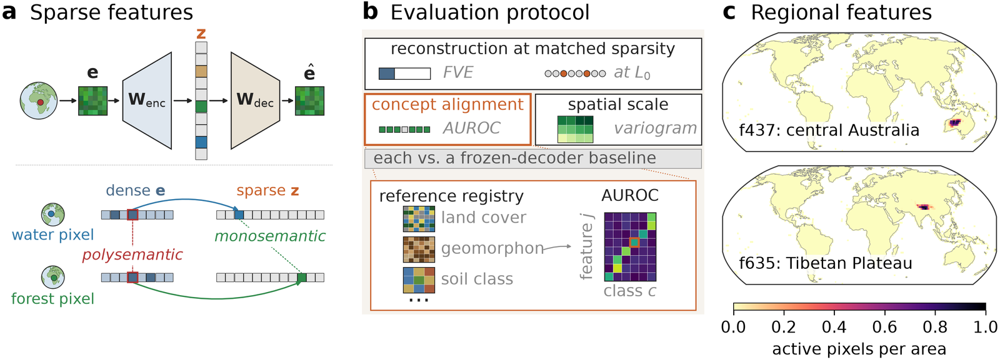
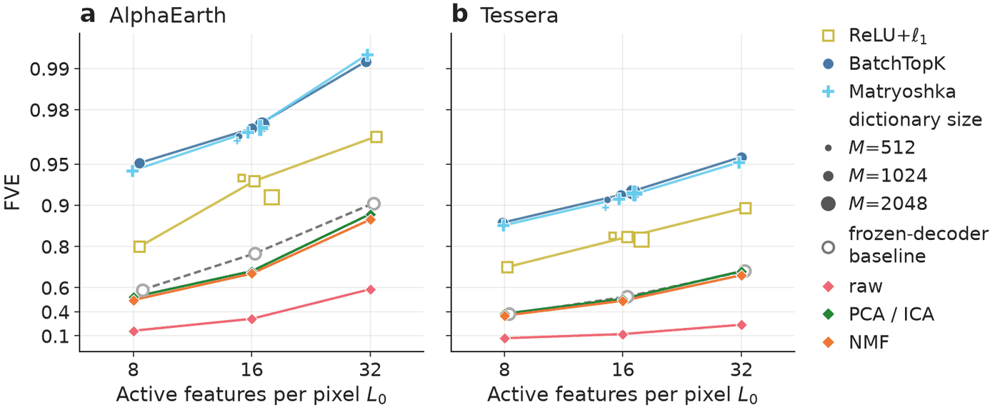
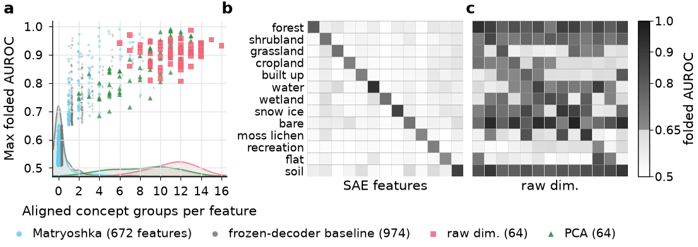
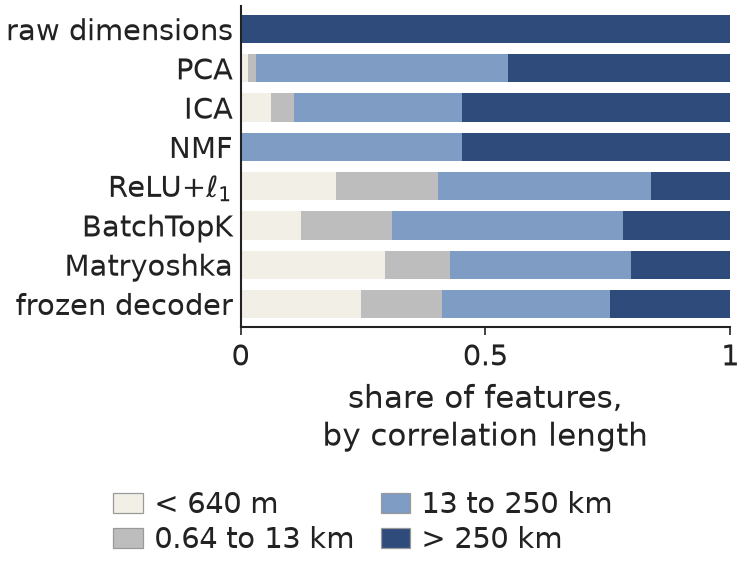
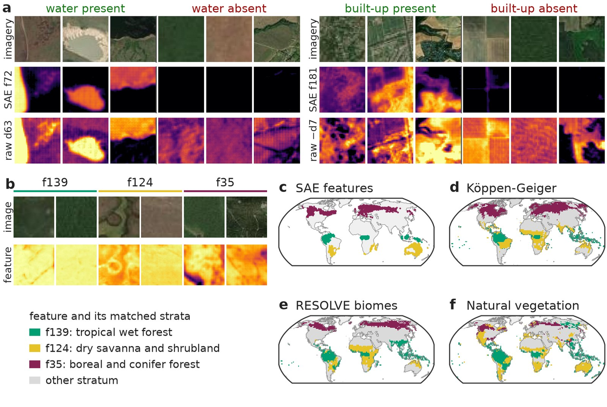

<div class="paper-hero" markdown>

# Decomposing Earth Embeddings with Sparse Autoencoders

<p class="paper-authors">
Vitus Benson<sup>1,2,3</sup> &emsp; Fanny Yang<sup>3</sup> &emsp; Markus Reichstein<sup>1,2</sup>
</p>

<p class="paper-affiliations">
<sup>1</sup>Max Planck Institute for Biogeochemistry, Jena, Germany &emsp;
<sup>2</sup>ELLIS Unit Jena, Jena, Germany &emsp;
<sup>3</sup>ETH Zürich, Zürich, Switzerland
</p>

<p class="paper-venue">NeurIPS 2026</p>

[:material-file-document: Paper][paper]{ .md-button .md-button--primary }
[:material-file-document-outline: arXiv](https://arxiv.org/abs/2611.11398){ .md-button }
[:material-github: Code](https://github.com/EarthyScience/geosae){ .md-button }
[:material-database: Data & checkpoints](https://doi.org/10.5281/zenodo.24046835){ .md-button }
[:material-refresh: Reproduce](reproduce-figures.md){ .md-button }

</div>

<figure markdown="span">
  
  <figcaption>(a) A sparse autoencoder (SAE) decomposes the embedding of each pixel into a sparse
  code whose features are meant to each stand for one concept, whereas a dense dimension mixes
  many. (b) The evaluation protocol scores reconstruction at matched sparsity, alignment with
  reference concepts and spatial scale, each against baselines, including an SAE with a frozen
  random decoder. (c) Where two SAE features are active: the share of pixels per 2°×2° cell.</figcaption>
</figure>

## TL;DR

Sparse autoencoders split Earth embeddings (AlphaEarth, Tessera) into sparse features that
reconstruct the embedding better than PCA, ICA or NMF at matched sparsity. On AlphaEarth, 88% of
the features align with at most one of 20 concept groups, where a raw dimension aligns with a
median of twelve. An SAE with a frozen random decoder is just as sparse in
its concepts and as fine in its spatial scale, so those properties come from sparsity; only a
trained dictionary also reconstructs the embedding accurately.

## Abstract

Earth observation foundation models produce global metre-resolution embeddings that underpin work
across agriculture, ecology, hydrology, and beyond. Yet these embeddings are opaque: each dimension
entangles unrelated physical concepts, which makes them difficult to interpret and their robustness
hard to assess. Here, we propose sparse autoencoders (SAEs) as a principled way to decompose Earth
embeddings into sparse, approximately monosemantic features over an overcomplete dictionary.
Because the standard practice of using LLMs to judge interpretations does not transfer to satellite
pixels, and spatial autocorrelation matters, we introduce a tailored evaluation protocol. It scores
any SAE on reconstruction at matched sparsity, alignment with reference concepts, and spatial scale,
each against baselines that include an SAE whose decoder is a frozen random dictionary. On this
protocol, SAEs reconstruct AlphaEarth and Tessera embeddings better than every baseline at matched
sparsity. Their features align with far fewer reference concepts than raw embedding dimensions (on
AlphaEarth, 88% align with at most one of 20 concept groups, most with none, against a median of 12
per raw dimension). They also carry more of their variance at fine spatial scales (23 to 32% within
a 640 m patch for BatchTopK and Matryoshka, against 9%). An SAE with a frozen random decoder shares
both properties, which therefore follow from sparsity, whereas only a learned dictionary
reconstructs the embedding accurately: on AlphaEarth, trained SAEs leave eight times less variance
unexplained. We test the sparse code on two applications, discovering land-cover sub-concepts and
detecting out-of-distribution pixels by area-of-applicability estimation. Both indicate how sparse
features could be used, but neither is yet reliable enough for practical use. Together, these
results are a step toward Earth observation models whose features can be inspected, opening
pathways for scientific discovery and more trustworthy geospatial applications.

## Key findings

### SAEs reconstruct better than every baseline

<figure markdown="span">
  
  <figcaption>Fraction of variance explained against the number of active features per pixel, on
  AlphaEarth (a) and Tessera (b). Every trained SAE lies above PCA, ICA, NMF and the raw
  dimensions at every sparsity, and well above the SAE with a frozen random decoder (grey).</figcaption>
</figure>

### Most features align with at most one concept

<figure markdown="span">
  
  <figcaption>(a) How many of 20 concept groups (water, built-up, forest, …) each feature aligns
  with. Most SAE features align with one or none, raw dimensions with many. (b, c) The best feature per
  concept group: the SAE's align with their own group, the raw dimensions' with several.</figcaption>
</figure>

### Features vary on finer spatial scales

<figure markdown="span">
  { width="480" }
  <figcaption>Share of features by the distance over which they stay correlated. SAE features vary over
  short distances more often than raw dimensions. The frozen-decoder SAE does too, so the fine
  spatial scale comes with sparsity.</figcaption>
</figure>

### Features find sub-concepts, but not reliably yet

<figure markdown="span">
  
  <figcaption>(a) The best water and built-up features fire on the class and stay silent
  elsewhere, unlike the best raw dimensions. (b–f) Three features of woody vegetation split it
  into tropical wet forest, dry savanna and boreal forest, matching climate, biome and vegetation
  maps. The frozen-decoder SAE has such features too, though they cover less of each region.
  Neither this nor the second application, area-of-applicability estimation, is yet reliable
  enough for practical use.</figcaption>
</figure>

## Reproducing the paper

Every figure and table can be drawn in two ways:

- **From the paper data:** run the figure script with `--paper-data <dir>` on the figure-data files
  of the [Zenodo record](https://doi.org/10.5281/zenodo.24046835). This draws the camera-ready
  figure from the exact numbers the paper was made from, in seconds, on a laptop.
- **From scratch:** build the data store, train the SAEs, run the evaluation stages, then run the
  same figure script. This takes about 80 GPU-hours and a store of about 465 GB.

[Reproducing: data, checkpoints and training](reproduce-data.md) sets up the environment, the
paper's data store, the Zenodo checkpoints and the training sweep.
[Reproducing the figures and tables](reproduce-figures.md) gives, for each figure and table, the
cells to train, the evaluation stages and both plotting commands.

The configs live in `configs/neurips2026/`
([README](https://github.com/EarthyScience/geosae/blob/main/configs/neurips2026/README.md)) and the
scripts in `scripts/neurips2026/`, one per figure or table. Every script takes `--out <dir>` and
writes a PDF and a PNG there, plus a JSON with the numbers the paper quotes; the table scripts also
write a LaTeX tabular. `python scripts/neurips2026/<script>.py -h` lists the arguments of each.

## Citation

The paper is on [OpenReview](https://openreview.net/forum?id=kB29xkjNQK) and
[arXiv](https://arxiv.org/abs/2611.11398).

Benson, V., Yang, F., & Reichstein, M. (2026). Decomposing Earth Embeddings with Sparse
Autoencoders. *Advances in Neural Information Processing Systems (NeurIPS 2026)*.

```bibtex
@inproceedings{benson2026decomposing,
  title     = {Decomposing Earth Embeddings with Sparse Autoencoders},
  author    = {Benson, Vitus and Yang, Fanny and Reichstein, Markus},
  booktitle = {Advances in Neural Information Processing Systems (NeurIPS 2026)},
  year      = {2026},
  url       = {https://openreview.net/forum?id=kB29xkjNQK}
}
```

## Acknowledgements

This work has received funding from the European Union under the Horizon Europe project
WeatherGenerator (grant agreement 101187947). It rests on openly shared data: the AlphaEarth
Foundations Satellite Embedding dataset (Google, Google DeepMind), Tessera, Copernicus-FM,
OlmoEarth, MMEarth, the MajorTOM grid, and the reference products listed in the paper.

[paper]: https://openreview.net/forum?id=kB29xkjNQK
