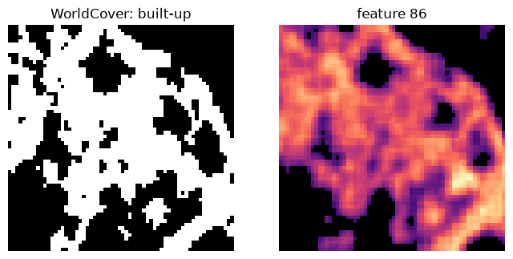

# Quickstart

This page builds a store of 225 patches around Jena, Germany, trains a BatchTopK SAE on their
AlphaEarth embeddings, measures how well it reconstructs them and how its features align with ESA
WorldCover land cover, and maps one feature. Every source it uses is public, so no account is
needed. On a laptop CPU the download takes about four minutes and training about four more.

## Installing

```bash
pip install "geosae[download,viz]"
```

The `download` extra fetches the data; `viz` brings `matplotlib` for the feature map at the end.

## Downloading a few hundred patches

`geosae download` takes the cells in `download.cells` and the products in `download.products`.
Here the cells are every land cell of the MajorTOM grid whose centre lies in a 1 x 0.7 degree box
around Jena, and the products are AlphaEarth embeddings from their public COG mirror and ESA
WorldCover 2021:

```bash
geosae download -c download -o download.out=data/quickstart.zarr \
    -o "download.cells.bbox=[11.0,50.5,12.0,51.2]" -o "download.products=[alphaearth_cog,lc_esa_wc]"
```

```
[geosae] 225 cells selected
[geosae] alphaearth_cog -> alphaearth: rows 0-225: 221/225 (149 s)
[geosae] lc_esa_wc -> lc_esa_wc: rows 0-225: 225/225 (36 s)
[geosae] alphaearth_cog -> alphaearth: 221/225 rows
[geosae] lc_esa_wc -> lc_esa_wc: 225/225 rows
[geosae] split_default: {'train': 156, 'val': 23, 'test': 42, 'excluded': 4}
[geosae] data/quickstart.zarr done in 3.1 min
```

Each cell is one 64 x 64 patch of 10 m pixels. The store splits them at random into training,
validation and test cells; the four cells without an embedding are excluded. See
[Building a dataset](dataset.md) for other ways of choosing cells, the other products, and
credentials.

## Training from the command line

Point every config at the store, then train with the bundled `batchtopk` recipe, shrunk by the
bundled `small` overlay (256 features, 8 active per pixel, 500 steps):

```bash
export GEOSAE_STORE=data/quickstart.zarr
geosae train -c batchtopk -c small
```

```
[geosae] run dir: runs/batchtopk/20261108-034936
[geosae] train=151 val=23 patches
[geosae] training 500 steps (5 epochs x 100 steps), batch=16 patches
...
[epoch 4] train_recon=0.0011 val_fve=0.7848 val_cos=0.9587 val_l0=8.0 dead=0.152 (36.8s)
[geosae] done. best val: {'fve': 0.7847641888688658, 'recon_cosine': 0.9587254602053916, ...}
```

The SAE explains 78% of the embedding variance (FVE) with 8 of its 256 features per pixel. The run
directory holds the resolved config, the checkpoints and the metrics; see [Training](training.md).
`device: auto` trained on the CPU here and uses a GPU when one is visible.

`geosae predict` writes the sparse codes of the test split and its reconstruction metrics, and
`geosae coverage` scores every feature against every WorldCover class, next to raw dimensions,
PCA, ICA and NMF on the same pixels:

```bash
geosae predict -c batchtopk -c small
geosae coverage -c batchtopk -c small
```

```
[geosae] test metrics: FVE=0.7767 cos=0.9616 L0=7.3
...
[geosae] sae: UCov=5/5 CCov=1.000 EMF=13.3 (median null best 0.529)
[geosae] raw: UCov=5/5 CCov=1.000 EMF=20.1 (median null best 0.547)
[geosae] pca: UCov=5/5 CCov=1.000 EMF=23.7 (median null best 0.551)
[geosae] ica: UCov=3/5 CCov=1.000 EMF=4.0 (median null best 0.552)
[geosae] nmf: UCov=5/5 CCov=1.000 EMF=35.3 (median null best 0.545)
```

Five WorldCover classes have enough test pixels to be scored, and every one is covered by some SAE
feature. [Evaluation](evaluation.md) explains UCov, CCov and EMF, and why a coverage count needs
its null and the frozen-decoder control before it says anything.

## Training in Python

Every stage is a function. [`PatchData`](api.md#geosae.data.dataset.PatchData) reads one split of
the store, [`build_model()`](api.md#geosae.models.registry.build_model) builds an SAE, and
[`Trainer`](api.md#geosae.train.trainer.Trainer) fits it:

```python
from geosae.data import PatchData
from geosae.models import build_model
from geosae.train import Trainer

store = "data/quickstart.zarr"
train, val = PatchData(store, split="train"), PatchData(store, split="val")
model = build_model({"type": "batchtopk", "input_dim": 64, "latent_dim": 256, "k": 8, "seed": 0})
best = Trainer(
    model, train, val, outdir="runs/quickstart", batch_size=16, epochs=5, steps_per_epoch=100,
    rampup=50, device="cpu", num_workers=0, log_every=500,
).fit()
print(f"validation FVE {best['fve']:.3f} at L0 {best['l0']:.1f}")
```

```
[geosae] dropping 5/156 cells holding a flat pixel
[geosae] training 500 steps (5 epochs x 100 steps), batch=16 patches
...
[epoch 4] train_recon=0.0010 val_fve=0.7967 val_cos=0.9609 val_l0=8.0 dead=0.117 (34.9s)
validation FVE 0.797 at L0 8.0
```

## Evaluating

[`reconstruction_metrics()`](api.md#geosae.eval.metrics.reconstruction_metrics) scores the test
split:

```python
from geosae.eval.metrics import reconstruction_metrics

test = PatchData(store, split="test")
metrics = reconstruction_metrics(model, test, device="cpu")
print({k: round(metrics[k], 3) for k in ("fve", "recon_cosine", "l0")})
```

```
{'fve': 0.793, 'recon_cosine': 0.965, 'l0': 7.453}
```

Concept alignment starts from a labelled pixel sample of the test split
([`sample_registry_pixels()`](api.md#geosae.eval.registry.sample_registry_pixels)), encoded by the
model ([`encode_sample()`](api.md#geosae.eval.registry.encode_sample)) and scored by
[`concept_auroc_matrix()`](api.md#geosae.eval.coverage.concept_auroc_matrix): the folded AUROC of
every feature as a one-feature classifier of every class. A class needs 50 positive pixels to be
scored:

```python
import numpy as np
from geosae.eval.coverage import concept_auroc_matrix
from geosae.eval.registry import encode_sample, sample_registry_pixels

sample = sample_registry_pixels(store, split="test", products=["lc_esa_wc"])
codes = encode_sample(model, sample.raw, device="cpu")
auc = concept_auroc_matrix(codes, sample.labels, sample.class_table, sample.product_order)
for c in np.flatnonzero(sample.n_positive >= 50):
    f = int(auc[:, c].argmax())
    print(f"{sample.concept_names[c]:<22} {sample.n_positive[c]:>5} px  feature {f:>3}  AUROC {auc[f, c]:.3f}")
```

```
Tree cover              4383 px  feature 233  AUROC 0.921
Grassland               1843 px  feature 233  AUROC 0.868
Cropland                3487 px  feature  97  AUROC 0.960
Built-up                 427 px  feature  86  AUROC 0.928
Permanent water bodies    67 px  feature 156  AUROC 0.903
```

Feature 86 separates built-up pixels from the rest best. The AUROC is folded, so a feature that
fires everywhere *except* on a class scores as high as one that fires on it; feature 233, the best
for both tree cover and grassland, is such a case.

## Mapping a feature

A model encodes inputs of any leading shape `(..., 64)`, so a whole patch goes through at once.
Here the most built-up test cell, read straight from the store, is encoded and feature 86 is drawn
next to WorldCover's built-up class:

```python
import matplotlib.pyplot as plt
import torch
import zarr

store_group = zarr.open_group(store, mode="r")
feature = int(auc[:, sample.concept_names.index("Built-up")].argmax())
built_up = {int(r): (store_group["lc_esa_wc"][r] == 50).mean() for r in np.unique(sample.cell)}
row = max(built_up, key=built_up.get)                                # the most built-up test cell
x = torch.as_tensor(store_group["alphaearth"][row])                  # (64, 64, 64)
with torch.no_grad():
    z = model.eval()(x)[1]                                           # (64, 64, 256) sparse codes
fig, axes = plt.subplots(1, 2, figsize=(8, 4))
axes[0].imshow(store_group["lc_esa_wc"][row] == 50, cmap="gray")
axes[0].set_title("WorldCover: built-up")
axes[1].imshow(z[..., feature], cmap="magma")
axes[1].set_title(f"feature {feature}")
for ax in axes:
    ax.set_axis_off()
print(row, feature, f"built-up {built_up[row]:.2f}, feature active {(z[..., feature] > 0).float().mean():.2f}")
```

```
44 86 built-up 0.52, feature active 0.75
```



The feature traces the settlement as one smooth region, while WorldCover's built-up mask breaks it
into buildings, roads and gardens: half of the patch is labelled built-up, but the feature is active
on three quarters of it.

## Going further

- [Building a dataset](dataset.md): other regions, random global samples, Tessera and 30-odd
  reference products.
- [Training](training.md): Matryoshka, ReLU+ℓ1 and the frozen-decoder control, and sweeps.
- [Inference](inference.md): the sparse code store `geosae predict` writes.
- [Evaluation](evaluation.md): the panel, calibrated coverage, spatial scale, sub-concepts and the
  area of applicability.
